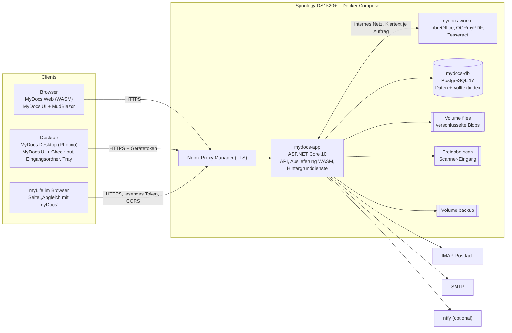
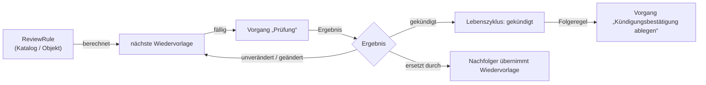
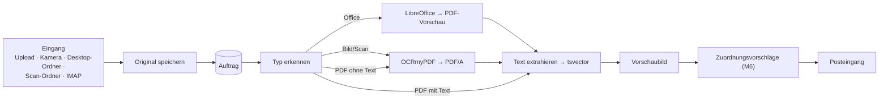
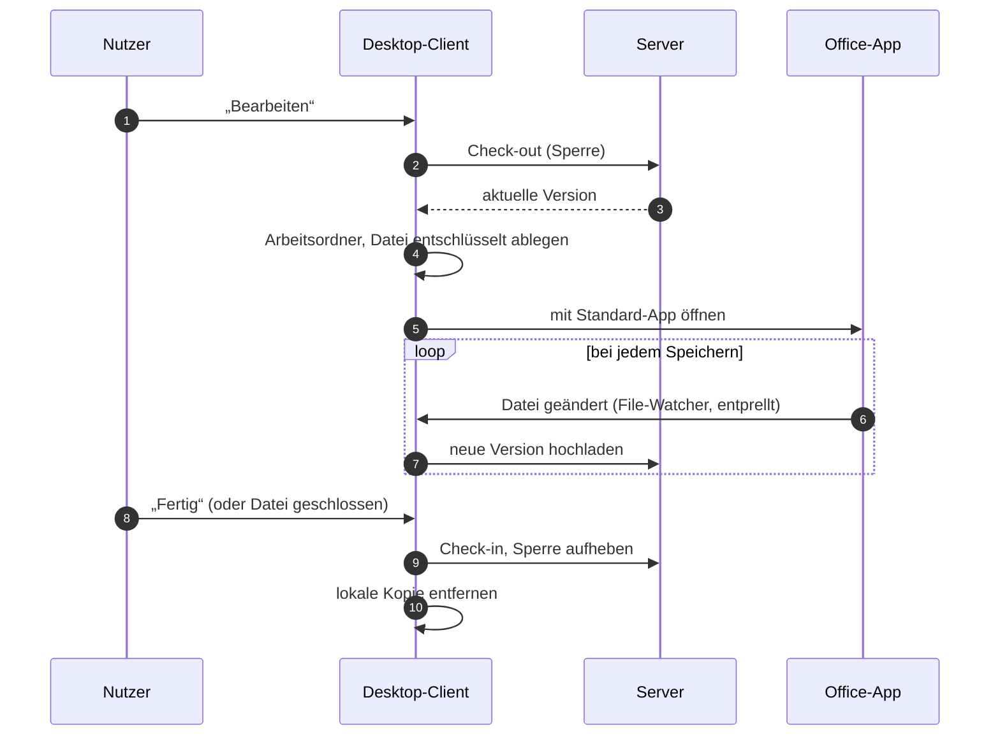
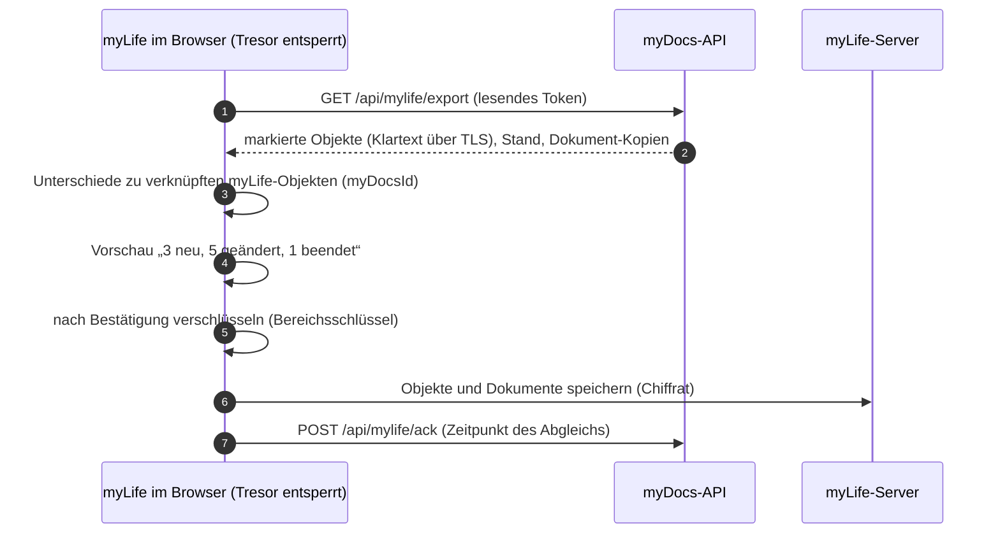

# myDocs – Architektur

Stand: 27.11.2026, Entwurf. Die Nummern in Klammern verweisen auf das [Entscheidungsprotokoll](entscheidungen.md). Objekttypen, Lebenszyklus und Prüfregeln stehen in [objekttypen.md](objekttypen.md).

## 1. Leitprinzipien

1. **myDocs ist der Alltag, myLife der Notfall (1).** myDocs führt Objekte und Dokumente und hält sie aktuell. myLife bekommt einen Auszug und bleibt ohne myDocs voll funktionsfähig.
2. **Nichts bleibt liegen.** Jedes Objekt hat eine zuständige Person und eine Wiedervorlage. Eine Prüfung endet nur mit einem Ergebnis (15).
3. **Eine Sprache für beide Apps.** Objekttypen, Felder und Auswahllisten kommen aus `MyCommon.Catalog` (6).
4. **Eine Oberfläche, zwei Hosts.** Browser und Desktop nutzen dieselben Komponenten über dieselbe API (37).
5. **Wenige bewegliche Teile.** PostgreSQL für Daten und Suche, ein Worker für die schwere Arbeit, keine weiteren Dienste (25, 43).

## 2. Nutzer, Haushalt und Rechte (4, 5, 31–35)

| Begriff | Bedeutung |
| --- | --- |
| **Benutzer** | Person mit Login. Nur der Administrator legt Benutzer an. |
| **Person** | Stammdaten (Name, Geburtsdatum …), mit oder ohne Benutzer. Wird in Objektfeldern als Beteiligte verwendet (Versicherungsnehmer, versicherte Person, Kontoinhaber). |
| **Haushalt** | Gemeinsamer Bestand. Mitglieder lesen und schreiben, Gäste lesen. |
| **Privates Objekt** | Gehört einer Person. Sichtbar für sie, für Personen mit Freigabe (lesen/bearbeiten) und für den Administrator im Modus „Admin-Einsicht“. |
| **Administrator** | Benutzer mit Zusatzrecht: Benutzer, Einstellungen, System. Sieht fremde private Objekte nur im Modus „Admin-Einsicht“. Jeder solche Zugriff erscheint im Audit-Log des Eigentümers. |

Die Rechte prüft immer der Server, in jeder Abfrage, auch in der Volltextsuche (26).

## 3. Komponenten



### Projekte

```text
my-common (eigenes Repo eckis-corner/my-common)
  MyCommon.Catalog   Schema, ObjectCatalog, Auswahllisten, Feldprüfungen, Lebenszyklus-Muster, ReviewRule, PaymentDefinition, Ressourcen
  MyCommon.Ui        Theme, AppLogo, LanguageMenu, UserMenu, Grundlayout, ObjectForm, ObjectDatasheet

myDocs (dieses Repo)
  src/
    MyDocs.Shared     DTOs, API-Verträge
    MyDocs.ApiClient  typisierter HTTP-Client, von MyDocs.UI genutzt
    MyDocs.UI         Razor Class Library: alle Seiten und Komponenten
    MyDocs.Web        Hosting im Browser (Interactive WebAssembly, ohne Prerendering)
    MyDocs.Server     ASP.NET Core: API, Identity, EF Core/Npgsql, Speicher, Hintergrunddienste
    MyDocs.Worker     Verarbeitung (Container mit LibreOffice, OCRmyPDF, Tesseract)
    MyDocs.Desktop    Photino.Blazor-Host, Check-out/Check-in, Eingangsordner, Tray
  tests/
    MyDocs.Tests      xUnit, bUnit, Integrationstests mit Testcontainers
```

| Komponente | Aufgabe |
| --- | --- |
| **MyDocs.UI** | Dashboard, Objekte (Formular und Datenblatt aus `MyCommon.Ui`), Vorgänge, Posteingang, Dokumente mit Versionen und Vorschau, Suche, Zahlungen, Admin. Greift nie direkt auf Dienste zu, nur über `MyDocs.ApiClient`. Plattformfunktionen (Datei öffnen, Ordner beobachten) über Schnittstellen, die nur der Desktop-Host implementiert. |
| **MyDocs.Server** | REST-API, Anmeldung (Cookie für den Browser, Token-Endpunkt für Geräte und für myLife), Rechteprüfung, Speicher, Volltextsuche, Audit-Log, Mail-Outbox. Hintergrunddienste: Wiedervorlage und Eskalation, tägliche Zusammenfassung, IMAP-Abruf, Scan-Ordner, Aufbewahrung, myLife-Abgleich, Papierkorb, Sicherung. |
| **MyDocs.Worker** | Zustandslos, ohne Datenbank und ohne Schlüssel (136): Die App nimmt einen Auftrag aus ihrer Tabelle, schickt die entschlüsselte Datei per HTTP und verschlüsselt PDF, Text und Vorschaubild aus der Antwort. Eine Datei gleichzeitig, Arbeitsdateien im tmpfs, kein Internet. Eigener Container, damit die App schlank bleibt. |
| **MyDocs.Desktop** | Hostet `MyDocs.UI` in der WebView des Systems. Dazu kommen Check-out/Check-in, Eingangsordner, Tray und Benachrichtigungen. |

### Warum so

- **WebAssembly statt Blazor Server (39):** Im Browser und im Desktop läuft dasselbe Ausführungsmodell (Komponente → API). Die Synology hält keine Verbindungen pro Sitzung, und auf dem Smartphone gibt es keine Abbrüche von SignalR.
- **Photino statt MAUI (36):** MAUI unterstützt kein Linux. Mit Photino bleibt die MudBlazor-Oberfläche erhalten, und der Client läuft als echtes .NET im Prozess. Weil die UI vollständig in `MyDocs.UI` liegt, bleibt ein späterer Wechsel des Hosts überschaubar.
- **Kein Zero-Knowledge (2):** OCR, Volltextsuche, Vorschau und Zuordnungsvorschläge setzen voraus, dass der Server die Inhalte lesen kann. Der Server steht beim Eigentümer. Für den Ernstfall bleibt myLife zuständig.

## 4. Anmeldung (40, 41)

| Client | Verfahren |
| --- | --- |
| Browser | ASP.NET Core Identity. Passwort plus TOTP oder Passkey (Fido2NetLib). Sitzungs-Cookie `HttpOnly`, `Secure`, `SameSite=Strict`, Antiforgery, Rate-Limiting, Sperre nach Fehlversuchen. |
| Desktop | Der Client öffnet den Systembrowser mit Authorization Code und PKCE und empfängt den Code über Loopback (`http://127.0.0.1:<port>`). Er erhält ein Zugriffstoken (kurz) und ein Refresh-Token je Gerät, gespeichert im Schlüsselspeicher des Betriebssystems. Geräte erscheinen unter „Konto → Geräte“ und sind widerrufbar. |
| myLife | Lesendes Token je Person, erzeugt in myDocs unter „Konto → myLife“. Bereich ist nur `mylife:read` für die eigenen markierten Objekte und für Haushaltsobjekte, bei denen die Person zuständig ist. |

## 5. Objekte, Lebenszyklus und Vorgänge (8–16)



- Der Dienst `ReviewService` (`BackgroundService`) prüft alle 15 Minuten. Er legt fällige Vorgänge an, setzt „läuft ab“ und „abgelaufen“ und führt die Eskalation durch: Tag 0, Tag 7, Tag 14 an den Haushalt, danach „überfällig“. Jeder Übergang ist idempotent und landet in der Historie. Zeiten laufen über `TimeProvider`.
- Die Folgeregeln des Lebenszyklus stehen im Katalog, die UI hat keine eigene Logik dafür.
- Zurückstellen verschiebt höchstens 30 Tage und verlangt eine Begründung.

## 6. Dokumente

### 6.1 Speicherung (22, 27)

- Jede Datei wird mit einem eigenen Schlüssel per AES-256-GCM verschlüsselt, in Blöcken von 1 MiB wie bei myLife. Der Dateischlüssel ist mit dem **Server-Hauptschlüssel** verpackt.
- Der Hauptschlüssel liegt in `data/app/keys`, nicht in der Datenbank. Er wird zusätzlich als 24 Wörter ausgedruckt und in myLife geführt (46).
- Ablage unter `files/<sha256 des Klartexts>`. Gleiche Inhalte werden nur einmal gespeichert. Damit der Hash nichts verrät, wird er mit einem Server-Geheimnis per HMAC gebildet.
- Jede Version ist unveränderlich. Ein Dokument hat eine aktuelle Version und eine Liste älterer Versionen, die sich wiederherstellen lassen.

### 6.2 Verarbeitung (23, 24)



Ableitungen (OCR-PDF, Vorschau, Text, Vorschaubild) gehören zu einer Version und können jederzeit neu erzeugt werden.

### 6.3 Office-Dokumente bearbeiten (17)



- Die Sperre zeigt in der Oberfläche an, wer die Datei gerade bearbeitet und seit wann. Sie läuft nach einer Frist ab, und ein Admin bzw. die Person mit der Sperre kann sie aufheben.
- Ohne Verbindung arbeitet man an der ausgecheckten Datei weiter. Die Versionen werden beim Wiederverbinden hochgeladen (38).
- Wurde die Sperre in der Zwischenzeit aufgehoben und gibt es eine neuere Version, entsteht **keine** stille Überschreibung, sondern eine Konfliktversion mit Hinweis.
- In Browser und Smartphone gibt es Download und PDF-Vorschau, keine Bearbeitung (18).

### 6.4 Posteingang und Mail (19, 20, 49)

- Der Scan-Ordner auf der Synology gehört zum Haushalt. Desktop-Eingangsordner, Kamera und IMAP landen privat bei der Person, von der der Eingang stammt.
- IMAP: nur hinterlegte Absender mit bestandener SPF- und DKIM-Prüfung. Anhänge nur aus einer Positivliste, Makros werden markiert, der Mailtext wird auf Wunsch als PDF abgelegt.

## 7. Suche (25, 26)

- `tsvector` mit Konfiguration `german` über Titel, Objektfelder, Dokumenttext, Notizen, Vorgänge und Kommentare, gewichtet (Titel A, Felder B, Text C).
- `pg_trgm` für Teilwörter und Tippfehler bei Titeln und Nummern (Policen-, Kunden-, Vertragsnummer, IBAN).
- Die Rechte sind Teil des SQL: Haushalt ∪ eigene ∪ freigegebene. Fremde private Objekte des Admins kommen nur im Modus „Admin-Einsicht“ dazu.

## 8. Brücke zu myLife (56–64)



- Verknüpft wird über `myDocsId` in der Nutzlast in myLife. Felder aus myDocs sind dort schreibgeschützt.
- Nur in myLife: Wünsche, Briefe, Bestattung, Organspende, Checkliste, Passwortmanager-Notfallzugang, Vertrauenspersonen, Notfallzugang.
- Änderungen in myLife:
  - Seite „Abgleich“
  - CSP `connect-src` um `https://mydocs.eckis-corner.de` erweitern
  - Anzeige „gepflegt in myDocs“ und „Stand ungeprüft seit …“
  - Status *beendet* für archivierte Objekte

## 9. Datenmodell (PostgreSQL, Entwurf)

| Tabelle | Wichtige Felder |
| --- | --- |
| `users` | Identity-Felder, PersonId, IsAdmin, Status, Sprache, Zeit für die Zusammenfassung |
| `persons` | Id, Name, Vorname, Geburtsdatum, UserId (optional) |
| `devices` | Id, UserId, Name, Plattform, RefreshTokenHash, LastSeenAt, RevokedAt |
| `api_tokens` | Id, UserId, Zweck (`mylife:read`), TokenHash, CreatedAt, RevokedAt |
| `objects` | Id, TypeKey, Title, Owner (Haushalt oder PersonId), ResponsibleId, LifecycleState, Fields (`jsonb`), SchemaVersion, ExpiryDate, NextReviewOn, LastReviewedAt, OverdueSince, InMyLife, ReplacedById, ArchivedAt, IsDeleted, DeletedAt, `xmin` |
| `object_shares` | ObjectId, PersonId, Recht (lesen/bearbeiten) |
| `object_history` | Id, ObjectId, At, ActorId, Feld, Alt, Neu |
| `review_rules` | ObjectId, Art, Parameter (überschreibt die Regel aus dem Katalog) |
| `tasks` | Id, Kind, Title, ResponsibleId, DueOn, Priority, State, WaitUntil, Outcome, Note, CreatedBy, ClosedAt |
| `task_objects` | TaskId, ObjectId |
| `comments` | Id, TaskId oder ObjectId, AuthorId, At, Text |
| `documents` | Id, Owner, DocumentKind, DocumentDate, Title, CurrentVersionId, InboxState, Source, RetentionUntil, InMyLife, IsDeleted |
| `document_versions` | Id, DocumentId, Nummer, BlobHash, Size, MimeType, FileName, CreatedBy, CreatedAt, HasMacros |
| `document_objects` | DocumentId, ObjectId |
| `derivatives` | VersionId, Art (ocrPdf, preview, thumbnail, text), BlobHash, Engine und Version |
| `blobs` | Hash, WrappedKey, Size, RefCount |
| `checkouts` | DocumentId, UserId, DeviceId, Since, ExpiresAt |
| `search_index` | Ressource, tsvector, Owner, Rechte-Kontext |
| `jobs` | Id, Art, Ressource, State, Versuche, NextAttemptAt, Fehler |
| `mail_senders` | PersonId, Adresse |
| `mylife_sync` | PersonId, LastAckAt |
| `settings`, `audit_log`, `mail_outbox` | wie myLife |

## 10. Betrieb (42–46)

- `docker-compose.yml` mit `app`, `worker` und `db`. Die App lauscht auf einem lokalen Port, Nginx Proxy Manager leitet `mydocs.eckis-corner.de` weiter.
- Images für `linux/amd64`, gebaut über GitHub Actions nach `ghcr.io/eckis-corner/mydocs` und `ghcr.io/eckis-corner/mydocs-worker`.
- Volumes: `data/app` (darin `files`, `keys`, `backup`), `data/postgres` und die Freigabe `scan`.
- Sicherung wie myLife, Rücksicherung per `restore`. Ohne `keys` und Hauptschlüssel sind die Dateien verloren.
- Die Desktop-Builds für Windows, macOS und Linux erzeugt die CI (Installer bzw. AppImage). Die Signierung ist noch offen.

## 11. Querschnitt

- **Lokalisierung:** `.resx` de/en, Grundbestand aus `MyCommon`.
- **Logging:** Serilog. Tokens, Hashes, Cookies und Dokumentinhalte werden nie protokolliert.
- **Audit-Log:** Anmeldung, Ansehen, Ändern, Herunterladen, Check-out und Check-in, Freigaben, Besitzwechsel, Admin-Einsicht, myLife-Export, Admin-Aktionen.
- **Sicherheits-Header:** CSP (`script-src 'self' 'wasm-unsafe-eval'`), HSTS über den Proxy, `X-Content-Type-Options`, `Referrer-Policy: no-referrer`. CORS nur für die Domain von myLife und nur für die Export-Endpunkte.
- **Tests:** xUnit (Regeln und Eskalation mit `FakeTimeProvider`, Rechte in der Suche), bUnit (Komponenten), Testcontainers (PostgreSQL, Worker), Ende-zu-Ende-Abläufe mit Playwright.
