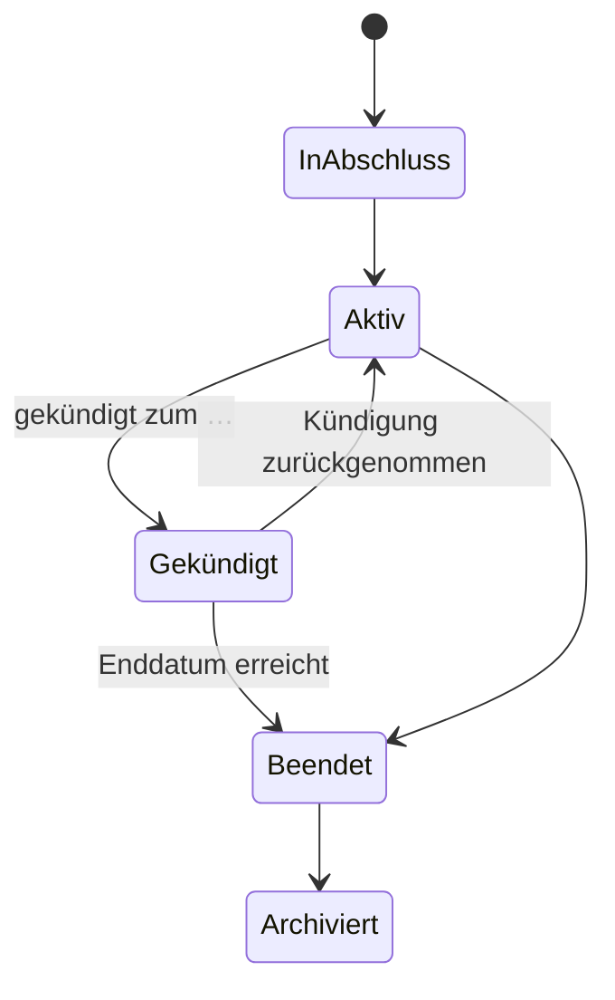
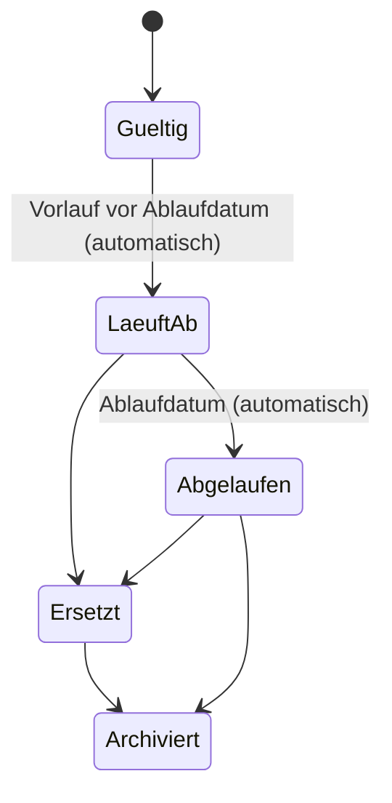

# myDocs – Objekttypen, Lebenszyklus und Prüfregeln

Stand: 27.11.2026, Entwurf. Die Objekttypen kommen aus `MyCommon.Catalog` (6). Grundlage ist der Katalog von myLife ([myLife/docs/objekttypen.md](https://github.com/eckis-corner/myLife/blob/main/docs/objekttypen.md)). Dieses Dokument beschreibt, was myDocs ergänzt.

## 1. Was jedes Objekt in myDocs zusätzlich hat

| Baustein | Beschreibung |
| --- | --- |
| Besitz | Haushalt oder Person (4, 34) |
| Zuständig | Person, bei Haushaltsobjekten Pflicht (12) |
| Lebenszyklus | Zustand nach dem Muster des Typs (9) |
| Wiedervorlage | Nächstes Datum aus den Prüfregeln, von Hand überschreibbar (13) |
| Zuletzt geprüft / überfällig seit | Aus den Vorgängen „Prüfung“ (14, 15) |
| Vorgänge | Offene und erledigte Vorgänge zum Objekt (11) |
| Dokumente | n:m, mit Versionen (21, 27) |
| Historie | Feldänderungen, Zustandswechsel, Besitzwechsel (27, 34) |
| Kommentare | Verlauf (50) |
| In myLife führen | Ja/Nein, vorbelegt aus `MyLifeRelevant` (57) |
| Nachfolger | Verweis bei „ersetzt durch …“ (10) |

## 2. Lebenszyklus-Muster (9, 10)

### Vertrag

| Übergang | Folgevorgang |
| --- | --- |
| → gekündigt | „Kündigungsbestätigung ablegen“, fällig nach 14 Tagen |
| → beendet | „Letzte Abrechnung prüfen“, „Lastschrift prüfen“ |

### Gültigkeit

| Übergang | Folgevorgang |
| --- | --- |
| → läuft ab | „Verlängern oder ersetzen?“ |
| → abgelaufen | „Ersatz anlegen“ |
| → ersetzt | Wiedervorlage geht auf den Nachfolger über |

### Bestand

*vorhanden → abgegeben/verkauft → archiviert.* Wird ein Objekt abgegeben, entsteht der Vorgang „Zugehörige Verträge prüfen“ (z. B. die Kfz-Versicherung beim Verkauf des Autos), mit den verknüpften Objekten als Liste.

## 3. Zuordnung der Typen aus myLife

| Typ | Muster | In myLife führen (vorbelegt) |
| --- | --- | --- |
| Persönliche Daten | – (kein Lebenszyklus) | ja |
| Ausweisdokument | Gültigkeit | ja |
| Bankkonto, Depot, Schließfach | Vertrag | ja |
| Karte | Gültigkeit | ja |
| Kredit / Darlehen | Vertrag | ja |
| Versicherung | Vertrag | ja |
| Vertrag / Abo | Vertrag | ja |
| Urkunde / Dokument | Gültigkeit | ja |
| Immobilie, Fahrzeug, Wertgegenstand | Bestand | ja |
| Online-Konto, Domain, Krypto-Wallet, Gerät | Vertrag (Domain) bzw. Bestand | ja |
| Kontakt | – | ja |
| Arbeitgeber, Altersvorsorge, Steuern | Vertrag bzw. – | ja |
| Ablageort | – | ja (63) |
| Bestattung, Organspende, Haustier, Brief, Sonstiger Wunsch, Aufgabe der Checkliste, Passwortmanager | **nur in myLife** (64) | – |

## 4. Zusatztypen nur in myDocs (7) – offen

`MyLifeRelevant = false`. Die Felder sind ein erster Vorschlag und müssen noch durchgesehen werden.

| Typ | Muster | Felder (Vorschlag) |
| --- | --- | --- |
| Rechnung / Beleg | – | Aussteller (Kontakt), Datum, Betrag, *Art* (Handwerker, Kauf, Arzt, Sonstiges), steuerlich relevant (Steuerjahr), bezahlt am, Konto (Verweis) |
| Garantie / Gewährleistung | Gültigkeit | Gegenstand (Verweis Gerät/Wertgegenstand), Händler, Kaufdatum, Garantie bis, Gewährleistung bis, Beleg (Verweis Rechnung) |
| Steuerjahr | Vertrag (offen → abgegeben → beschieden → bestandskräftig) | Jahr, Finanzamt, Steuerberater (Kontakt), Abgabefrist, Bescheid vom, Einspruchsfrist |
| Korrespondenz | – | Absender/Empfänger (Kontakt), Datum, Betreff, Bezug (Verweise) |
| Gesundheit | – | Person, Arzt (Kontakt), *Art* (Befund, Impfung, Rezept, Bescheid), Datum |
| Schule / Ausbildung | – | Person, Einrichtung, *Art* (Zeugnis, Bescheinigung, Vertrag), Datum |

## 5. Prüfregeln (13) – offen

Arbeitsstand für die Standardwerte. Jedes Objekt kann sie überschreiben.

| Typ | Prüfintervall | Fristregel |
| --- | --- | --- |
| Versicherung | 12 Monate | 6 Wochen vor dem letzten Kündigungstermin (Hauptfälligkeit minus Kündigungsfrist) |
| Vertrag / Abo | 6 Monate | 4 Wochen vor Ende der Mindestlaufzeit bzw. dem nächsten Kündigungstermin |
| Kredit | 12 Monate | 6 Monate vor dem Ende der Zinsbindung |
| Bankkonto, Depot | 12 Monate | – |
| Ausweisdokument, Karte | – | 3 Monate vor dem Ablauf |
| Urkunde (Vollmachten, Verfügungen) | 24 Monate | – |
| Garantie | – | 4 Wochen vor dem Ende der Garantie |
| Steuerjahr | – | 6 Wochen vor der Abgabefrist, 2 Wochen vor dem Ende der Einspruchsfrist |

## 6. Dokumentarten und Aufbewahrung (28) – offen

| Dokumentart | Aufbewahrung (Vorschlag) | Bezugspunkt |
| --- | --- | --- |
| Police / Vertrag | bis 3 Jahre nach dem Ende | Ende des Objekts |
| Beitrags- und Änderungsmitteilung | 3 Jahre | Dokumentdatum |
| Rechnung Handwerker / Dienstleistung am Grundstück | 2 Jahre (§ 14b UStG), steuerlich ggf. länger | Ende des Jahres |
| Kaufbeleg mit Garantie | bis zum Ende der Garantie | Objekt Garantie |
| Steuerbescheid und Belege | bis zur Bestandskraft, Empfehlung 10 Jahre | Steuerjahr |
| Renten- und Versicherungsverlauf, Urkunden | dauerhaft | – |
| Kontoauszug | 10 Jahre bei steuerlichem Bezug, sonst 3 Jahre | Dokumentdatum |
| Korrespondenz | 3 Jahre | Dokumentdatum |
